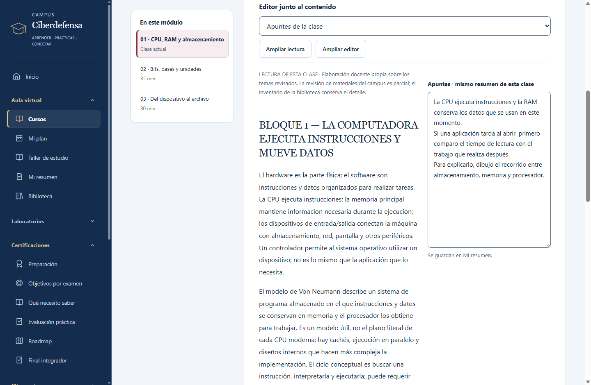

# Taller de estudio

El taller conecta el aula, las dudas, la práctica y la revisión de evidencias. Funciona con tu perfil local y usa los mismos apuntes e informes que el resto del campus.

Capturas de la aplicación con un perfil de prueba. También podés ver las [sesiones guiadas](ui-preview/taller-sesiones.png) y la [preparación por objetivo y versión](ui-preview/taller-preparacion.png).

## Estudiar con dos paneles

Abrí una clase y elegí la vista dividida. Podés tener la teoría o consigna junto a tus apuntes o la respuesta de práctica. El control de proporción también se ajusta con el teclado. Ampliá un panel cuando necesites concentrarte; en ventanas estrechas, los paneles se apilan.

El texto pertenece a la clase: lo vas a encontrar también en **Mi resumen** o al volver a la práctica. No necesitás copiarlo a otro cuaderno. Las preguntas de comprobación y el resumen completo siguen disponibles en sus pasos habituales.

## Una sesión concreta

Desde **Taller de estudio → Sesiones**, elegí una clase y un presupuesto de **30, 60 o 90 minutos**. Se crea una secuencia de recuperar una idea, practicarla y reflexionar/comprobar. Los tiempos son orientativos: completar un bloque es una acción tuya, no el resultado de un cronómetro.

Podés pausar y retomar la sesión. El plan elegido se conserva; cambiar el diagnóstico no reemplaza sus pasos. Al volver al aula, el campus usa el punto de reanudación guardado. Terminar los bloques registra actividad, sin acreditar dominio del tema.

Al retomar, se muestra el editor guardado de apuntes o respuesta, aunque hayas cambiado la vista mientras la sesión estaba pausada. Se recuperan la selección y las posiciones de lectura y del editor. Las tarjetas muestran la clase, duración y estado; **Detalles del registro** conserva los identificadores y las fechas exactas. Los horarios usan la zona del equipo indicada en pantalla; las fechas sin hora conservan su día.

## Errores y dudas

Anotá qué te confundió, tu explicación actual, la causa que reconocés y, si querés, tu confianza. Vinculá la entrada con una clase, base u objetivo. El campus permite elegir una recuperación diferente del ejercicio que disparó la duda.

Conservá tu respuesta al nuevo ejercicio y declará el resultado y la ayuda recibida. Podés dejarlo pendiente, indicar que todavía no estás seguro o declarar la duda resuelta. Una respuesta larga o una confianza alta no la resuelve automáticamente.

Hay una sola recuperación en borrador a la vez. Antes de escribir en otra entrada, elegí **Conservar intento de recuperación** o **Descartar este borrador de recuperación**. El aviso identifica la entrada pendiente y permite consultar su respuesta guardada. Si hay una respuesta rechazada, podés copiarla desde **Copiar respuesta rechazada**, corregirla o descartar sólo esa respuesta. Descartar el borrador válido y descartar el texto rechazado son acciones separadas; ninguna borra los apuntes de tus clases.

Los límites aparecen en los editores. Si un texto no se puede guardar, corregilo o copialo antes de salir; el aviso ofrece volver al editor. Cancelar conserva el texto. A capacidad, exportá una copia y decidí qué entrada quitar: el campus no poda el historial automáticamente.

Quitar una entrada elimina su historial y sus propios borradores. Quitar una sesión elimina su plan, reflexión y posición guardada; los apuntes y respuestas de la clase se conservan. Los textos rechazados deben corregirse o descartarse explícitamente antes de confirmar la eliminación.

## Reconstruir una base

El mapa muestra las relaciones entre doce bases del recorrido. Cada base reúne clases, explicación breve, ejemplo y preguntas de recuperación. Las relaciones aconsejan un orden de estudio; podés abrir cualquier clase sin desbloquear materias.

Los estados reflejan actividad registrada y dudas abiertas. Leer una explicación no convierte automáticamente una base en competencia demostrada.

## Retos Windows/Linux

Hay tres familias de transferencia, con dos variantes cada una: permisos, servicios y recuperación. Cada caso compara artefactos originales de Windows y Linux y pide justificar qué se mantiene y qué cambia.

El análisis de datos sintéticos se identifica como documental. Encender una VM, abrir un archivo o completar un informe no demuestra que ejecutaste la práctica. Registrá el entorno, alcance, procedimiento, límites y ayuda con honestidad.

Los retos usan **Evaluación práctica** y sus informes entregados e inmutables. Consultar orientación o repetir una variante queda separado de tu declaración original de independencia; la exposición también se considera dentro de la misma familia. Se pueden revisar y exportar con las herramientas existentes. El registro admite hasta doce intentos por perfil; al llegar al límite, conservá una copia de tus informes y continuá en otro perfil.

## Preparación para diciembre

Elegí explícitamente el catálogo y su versión. Security+ 701 y 801 permanecen separados; CCST mantiene la identificación del mapa provisional del curso. La fecha objetivo corresponde a la configuración de **Mi plan**.

Cada objetivo muestra actividad relacionada, avance declarado y evidencias con fecha, ayuda, ejecución y revisión. La ventana de treinta días organiza la recencia; no es una garantía de retención. Los datos sin fecha quedan con fecha desconocida, y una fecha futura no se cuenta como práctica reciente.

Una declaración de «sin ayuda» sigue siendo una declaración. Los borradores, notas, actividades completadas y análisis documentales se distinguen de una entrega con ejecución declarada. El panel ayuda a elegir qué reforzar, sin calcular probabilidad de aprobar ni otorgar una insignia de preparación oficial.

## Conservar y revisar el trabajo

La copia JSON conserva el taller completo. Al combinar equipos, elegís el registro del taller local, entrante o ambos con alternativa conservada; no se mezclan pasos de sesiones diferentes. El portafolio resume los textos y actividades seleccionados y conserva sus límites de extensión; el respaldo contiene los originales completos.

Las preferencias y el progreso se guardan fuera de la instalación. Actualizar la aplicación conserva los perfiles. Las funciones del taller no requieren nuevos motores ni servidor; los laboratorios reales conservan sus requisitos existentes.
