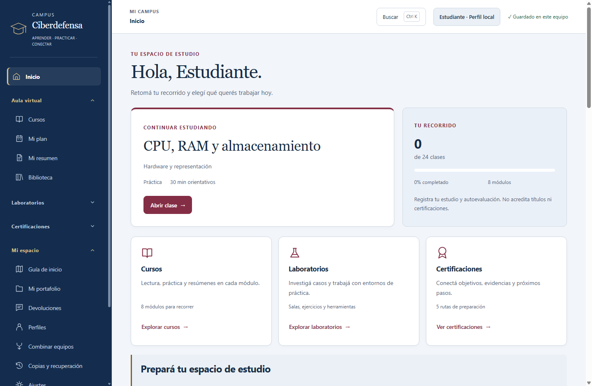

# Tu campus universitario

La interfaz usa azul y bordó, con una portada centrada en retomar el estudio. Tus perfiles, apuntes, informes y preferencias siguen en este equipo y se conservan al actualizar.

Estas capturas corresponden a la aplicación de escritorio con un perfil de prueba. También podés ver el [aula con índice de clases](ui-preview/aula-clara.png) y el [inicio en modo oscuro](ui-preview/inicio-oscuro.png).

## Dónde encontrar cada cosa

El menú reúne las herramientas en cuatro áreas. Abrí el título de un área para ver sus opciones; al entrar a una sección, su área queda abierta.

| Área | Para qué usarla |
|---|---|
| Inicio | Retomar la siguiente clase, ver el avance real y entrar a cursos, laboratorios y certificaciones. |
| Aula virtual | Cursos del año, plan de estudio, resumen propio y biblioteca. |
| Laboratorios | Salas prácticas, ejercicios, sistemas Windows/Linux, paquetes, escritorios VM, red de práctica y forense. |
| Certificaciones | Preparación, objetivos por examen, competencias, evaluaciones prácticas, roadmap y final integrador. |
| Mi espacio | Portafolio, devoluciones, perfiles, combinación entre equipos, copias y ajustes. |

La búsqueda de la cabecera también se abre con **Ctrl + K**. Permite ir directamente a contenidos, objetivos y casos. El nombre de la ubicación actual aparece en la cabecera.

## Estudiar una clase

Entrá a **Aula virtual → Cursos** o continuá desde Inicio. El aula muestra el módulo, su índice de clases y los cuatro pasos del estudio: **Teoría**, **Práctica**, **Comprobar** y **Mi resumen**. Podés elegir otra clase desde el índice y volver a tus apuntes. El campus usa el progreso registrado para elegir el paso desde el que retomás.

Las barras representan avance registrado. La lectura, los resúmenes y las autoevaluaciones forman parte de tu preparación; no acreditan una certificación oficial.

## Adaptarlo a vos

En **Mi espacio → Ajustes** podés elegir tema claro, oscuro o el del sistema; ampliar el texto, usar alto contraste o más espaciado, reducir movimiento y activar concentración. Las preferencias se guardan en el perfil. En una ventana estrecha, abrí el menú de navegación desde la cabecera; podés cerrarlo con **Escape**.

**Tab** recorre los controles y **Enter** o **Espacio** abre los grupos del menú. “Saltar al contenido” permite pasar directamente al aula. El estado del guardado sigue visible en la cabecera; si un texto supera un límite, el campus conserva el texto en la sesión y muestra cómo volver a corregirlo o copiarlo.

## Actualizar

La aplicación instalada consulta las versiones publicadas al abrirse. También podés usar **Ajustes → Buscar actualizaciones**. Cuando una actualización está lista, el campus ofrece guardar y reiniciar. El archivo HTML antiguo es un acceso anterior: para usar esta interfaz, abrí la aplicación **Campus Ciberdefensa** instalada.

La aplicación funciona sin servidor. Las fuentes externas y las actualizaciones necesitan Internet. Los laboratorios mantienen sus requisitos: Docker para las salas y VirtualBox e instalación manual del sistema invitado para las VMs. El rediseño no instala esos componentes ni enciende máquinas por sí solo.

Para la preparación y las herramientas avanzadas, consultá también la [guía de estudio y laboratorios](advanced-user-guide.md).
